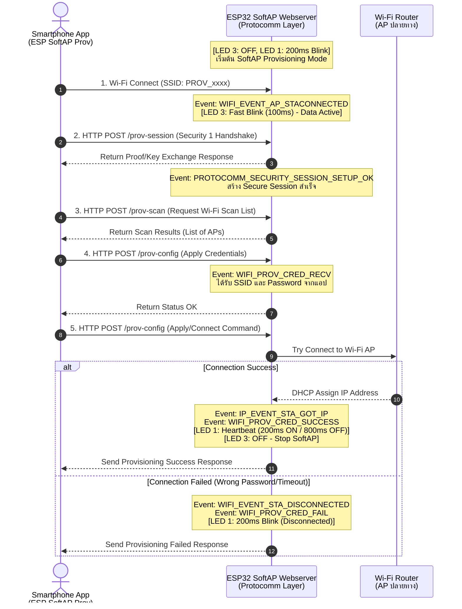

## 5. กิจกรรมถอดรหัสซอร์สโค้ดและเขียนผังงาน (Code Deconstruction & Sequence Flow Assignment)

ให้นักศึกษาแกะรอยการทำงานจาก `main/main.c` ในโหมด SoftAP แล้วเขียน **แผนภาพลำดับเหตุการณ์ (Sequence Diagram)**:

### ภารกิจที่ 1: ผังลำดับการสื่อสารผ่าน HTTP Endpoints (SoftAP Scheme Sequence Flow)
ให้นักศึกษาวาด Sequence Diagram แสดงปฏิสัมพันธ์ระหว่าง 3 ฝ่าย:
1. **Smartphone App (ESP SoftAP Prov)**
2. **ESP32 SoftAP Webserver (Protocomm Layer)**
3. **Wi-Fi Router (AP ปลายทาง)**

**จุดที่ต้องระบุในผัง:**
- จังหวะที่มือถือยิง HTTP POST ไปยัง Endpoint แต่ละตัว (`/prov-session`, `/prov-scan`, `/prov-config`)
- Event ของ ESP-IDF ที่ถูก Trigger ใน `event_handler()` เช่น:
  - `WIFI_EVENT_AP_STACONNECTED`
  - `PROTOCOMM_SECURITY_SESSION_SETUP_OK`
  - `WIFI_PROV_CRED_RECV`
  - `WIFI_PROV_CRED_SUCCESS`
  - `IP_EVENT_STA_GOT_IP`
- สถานะจังหวะการกระพริบของ **LED 3 (GPIO 5)** และ **LED 1 (GPIO 2)** ในแต่ละช่วง

```text



---

## 6. ตารางบันทึกผลการทดลอง (Experiment Results)

| รายการตรวจสอบ | ค่าที่บันทึกได้จากการทดลอง |
| :--- | :--- |
| **1. ชื่อ SoftAP SSID ของ ESP32** | `PROV_67030067` |
| **2. รหัส PoP (Proof of Possession)** | `abcd1234` |
| **3. ข้อความใน QR Code Payload (JSON)** | `{"ver":"v1","name":"PROV_67030067","pop":"abcd1234","transport":"softap"}` |
| **4. พฤติกรรมไฟ LED 3 (GPIO 5) ช่วงรอ vs ช่วงส่งข้อมูล** | ช่วงรอ: **ติดค้าง (ON) หรือ ดับ (OFF)**<br/>ช่วงส่ง: **กระพริบถี่ (100ms Mark / 100ms Space)** |
| **5. IP Address ที่ ESP32 ได้รับจาก Router** | `192.168.1.XX` |
| **6. เวลาที่ใช้ตั้งแต่เริ่มจนจบกระบวนการ (วินาที)** | ประมาณ `15 - 25` วินาที |
---

## 7. คำถามท้ายการทดลอง (Post-Lab Questions)
1. ในโหมด SoftAP Scheme สมาร์ตโฟนส่งข้อมูลหา ESP32 ผ่านโปรโตคอลและ IP Address ใด?
คำตอบ ส่งข้อมูลผ่านโปรโตคอล HTTP (POST) เหนือชั้น Transport Layer TCP/IP โดยยิงไปยัง IP Address 192.168.4.1 (ซึ่งเป็นค่า Default Gateway IP Address ของตัว ESP32 ในโหมด SoftAP)

2. หากผู้ใช้ป้อนรหัสผ่าน Wi-Fi ผิดในแอปมือถือ จะเกิด Event ใดขึ้นบน ESP32 (WIFI_PROV_CRED_FAIL หรือไม่) และ ESP32 มีพฤติกรรมอย่างไร?
คำตอบ เกิด Event WIFI_PROV_CRED_FAIL ขึ้นบน ESP32 (หลังจากเกิด WIFI_EVENT_STA_DISCONNECTED) โดย ESP32 จะส่งสถานะล้มเหลวกลับไปยังสมาร์ตโฟน จากนั้น ESP32 จะยังคงเปิดโหมด SoftAP ไว้เช่นเดิม และรอรับการป้อน Credentials (SSID/Password) ชุดใหม่จากแอปพลิเคชันโดยไม่ทำการ Restart บอร์ด

3. ทำไมผู้ผลิต IoT ส่วนใหญ่จึงมองว่ากระบวนการเชื่อมต่อแบบ SoftAP มีขั้นตอนที่ยุ่งยากสำหรับผู้ใช้ทั่วไปเมื่อเทียบกับ BLE?
คำตอบ การสลับ Wi-Fi Connection: ผู้ใช้ต้องสลับการเชื่อมต่อ Wi-Fi ของสมาร์ตโฟนออกจาก Router เพื่อไปต่อกับ SoftAP ของอุปกรณ์ก่อน แล้วค่อยสลับกลับ ซึ่งระบบปฏิบัติการ (โดยเฉพาะ iOS) มักจะมี Pop-up เตือนเรื่อง "No Internet Access" หรือสลับ Wi-Fi กลับเองอัตโนมัติ
ความซับซ้อนของ OS Permission: ต้องเปิดตำแหน่ง (Location Permissions) และกดยืนยันการต่อ Local Network หลายขั้นตอน
เปรียบเทียบกับ BLE: โหมด BLE สามารถค้นหา แลกเปลี่ยน Key และส่ง Wi-Fi Credentials ได้ทันทีใน Background โดยที่มือถือไม่ต้องตัดการเชื่อมต่อจาก Wi-Fi บ้านเลย ทำให้ประสบการณ์ใช้งาน (UX) ลื่นไหลและง่ายกว่ามาก

